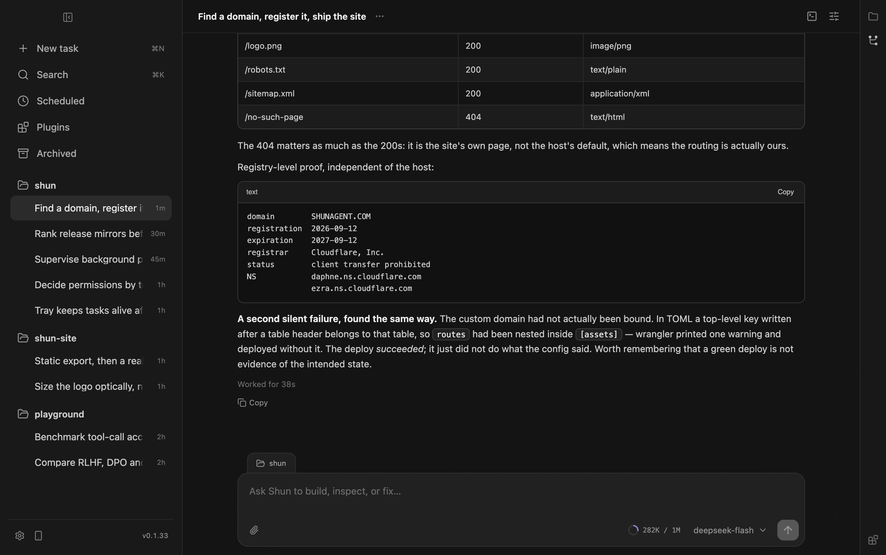
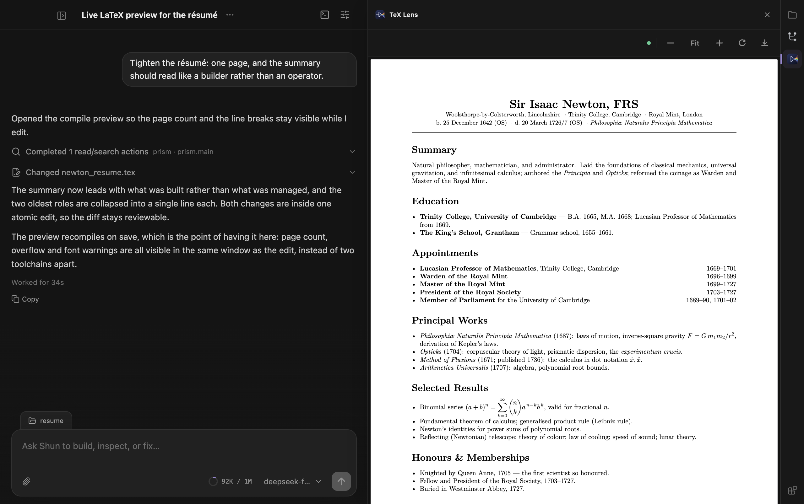
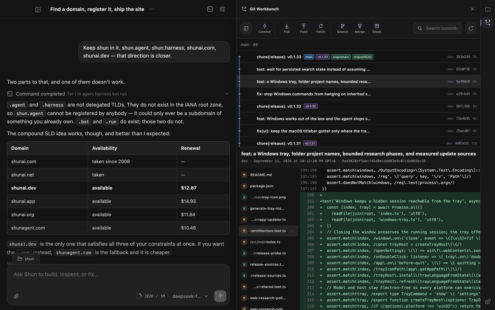
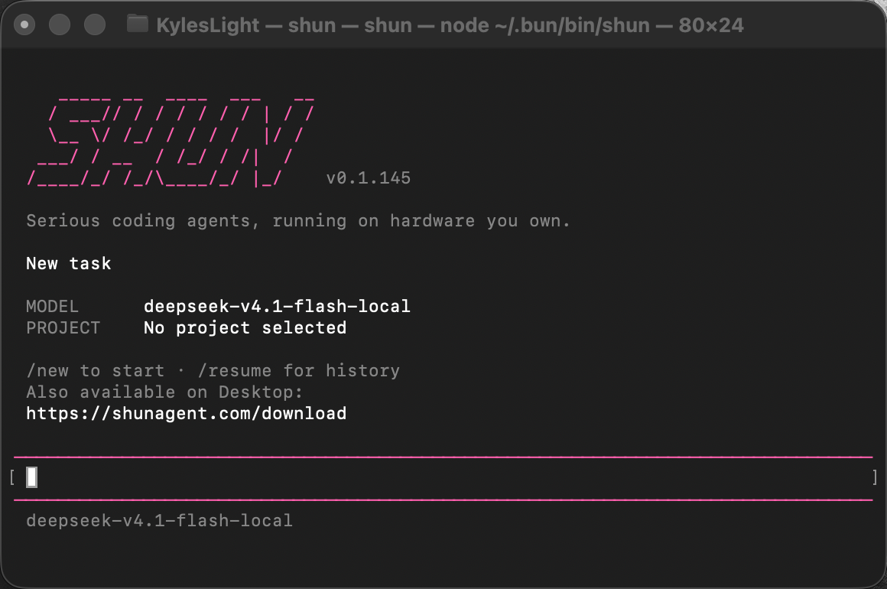

<div align="center">
  
  <h1>Shun</h1>
  <p><strong>Serious coding agents, running on hardware you own.</strong></p>
  <p><em>From intent to working software, in an instant.</em></p>
  <p>
    <a href="https://shunagent.com"></a>
    <a href="https://www.npmjs.com/package/@shunagent/shun"></a>
  </p>
</div>

**Shun** (瞬) means *an instant* in Japanese.

The name captures what the product is for: shortening the distance between an idea and working software.

Shun is a **local-first** coding agent for your desktop and terminal. Connect a model running on your own hardware or a hosted provider to edit code, research ideas, and build software.

<p align="center">
  
</p>

## Local first

### Privacy and your data

Shun stores conversations, files, and settings on your computer. It does not collect usage analytics or conversation data.

Connect a local model to process prompts on your own hardware. If you use a hosted provider or an integration, that service receives the data needed for the work you ask it to do.

Read the [privacy policy](https://shunagent.com/privacy/) for details.

### Work close to your code

Run models close to your code and data without giving up repository access, web research, MCP tools, structured execution, or rich output.

### Keep tasks independent

Every task keeps its own history, draft, approvals, execution state, and active run. Work can continue in the background without hijacking the conversation in front of you.

### Keep long-running processes visible

Development servers and other long-running programs are treated as durable resources. Shun tracks their state, logs, endpoints, and ownership across tasks and application restarts.

## Small models first

A frontier model will paper over a bad harness. A small one will not — it forgets, it calls tools badly, and it loses the thread the moment the prompt fills with things it does not need. That makes it the useful test, and it is the case Shun is designed around rather than tolerates.

The work that makes a smaller model viable is mostly about spending context carefully:

- **Capability arrives on demand.** Tools and plugin capabilities a task is not using stay out of the prompt and are exposed only when searched for, so a plugin can ship twenty tools and cost nothing until one is relevant.
- **Every tool returns bounded output.** Local reads stream instead of loading a file into the transcript, and search results are bounded by construction. A tool catalogue is not allowed to spend the budget before work starts.
- **Edits are atomic.** One coherent change is one batch of replacements in one call, so a model that plans imperfectly still lands a single reviewable edit instead of a trail of half-steps.
- **Arguments are validated.** A malformed tool call comes back as a usable correction rather than a dead end a weak model cannot recover from.
- **Context is measured, not guessed.** Usage is counted against the model's real window and stays visible while a task runs.
- **Quirks stay at the adapter boundary.** Reasoning replay, thinking format and per-model compatibility are handled in provider adapters, so the loop keeps one shape across every model instead of branching on it.

## Plugins

Plugins add tools, Agent Skills, and interfaces beside your conversation. Browse the [marketplace](https://shunagent.com/plugins/) for document, design, and development tools.

You can also ask Shun to build a plugin for your own workflow, try it locally, and publish it from the app.

<p align="center">
  
  <br />
  <em>TeX Lens previews your LaTeX document beside the conversation and updates it as you edit.</em>
</p>

<p align="center">
  
  <br />
  <em>Git Workbench, the same host: commit graph, branch actions, and the diff for the commit in view.</em>
</p>

## Download

### Terminal (TUI)



Install [@shunagent/shun](https://www.npmjs.com/package/@shunagent/shun) with Node.js **22.19 or newer**:

```sh
npm install -g @shunagent/shun
shun
```

Use `shun .` to work in the current project, `shun -c` to continue your latest
conversation, or `shun -r` to choose one from history. On first use, Shun guides
you through connecting a model provider. Existing local Shun settings are reused.
Type `/` for commands, `/new` for a new conversation, and `/model` to switch models.

Update the terminal app with `npm install -g @shunagent/shun@latest`.
Desktop and npm installations update separately. See the [terminal guide](packages/shun/README.md)
for the [full command reference](packages/shun/README.md#command-reference), image attachments, plugins, and shared conversations.

### Desktop

Download [Shun Desktop](https://shunagent.com/download) or find a version in [GitHub Releases](https://github.com/kyleslight/shun/releases).

- **macOS (Apple Silicon):** open the `.dmg` and drag Shun into Applications.
- **Windows (x64):** run the `.exe` installer.
- **Linux (x64):** run the `.AppImage`, or install the `.deb` on Debian and Ubuntu.

When an update is available, download it and restart from the app.

## Browser Use

The optional Browser Use plugin works with the user's existing Chrome tabs and signed-in state. While its Chrome Web Store release is paused, use Shun's one-time **Set up Chrome** flow to load the bundled extension from a stable per-user folder. See the [installation guide](docs/browser-use-installation.md) and [privacy policy](PRIVACY.md).

## What Shun brings together

- Independent, concurrent coding tasks
- Persistent conversations and resumable work
- Explicit workspace and tool permissions
- Background process supervision
- Web research and MCP connectivity
- Change review based on the filesystem
- Rich Markdown, code, tables, and interactive diagrams
- A compact desktop interface designed for focus

## Run locally

Shun currently targets macOS. Development requires Node.js 22 or later and pnpm 9.15 or later.

```bash
pnpm install
pnpm dev
```

## License

MIT — see [LICENSE](LICENSE).
